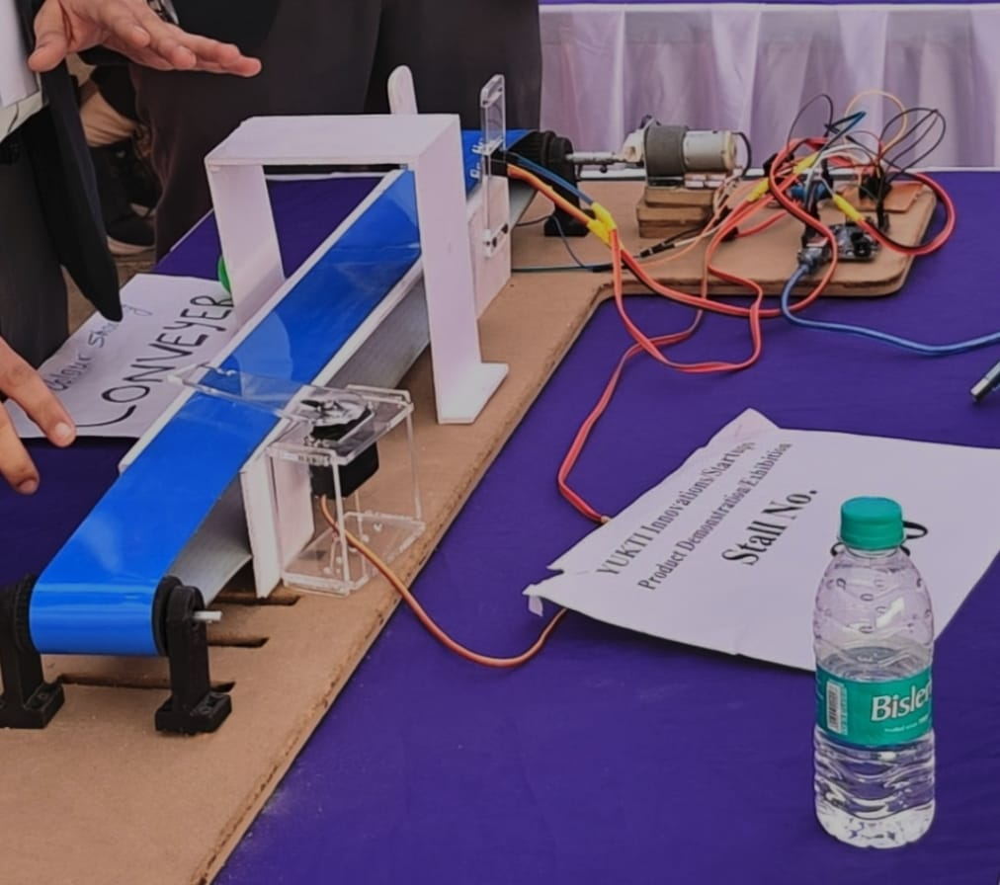
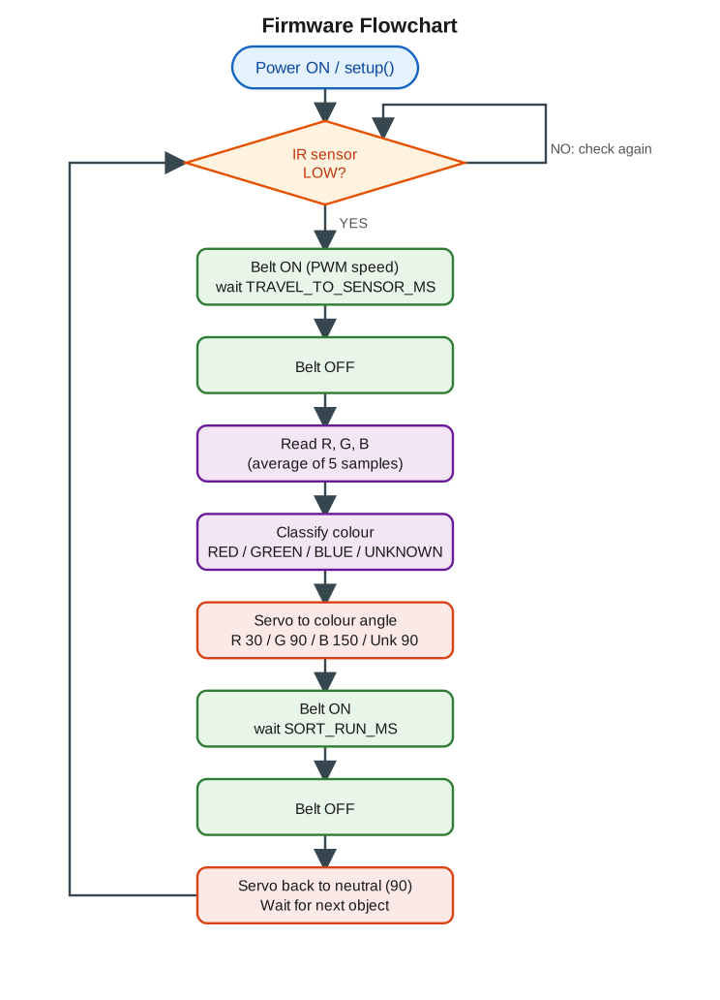
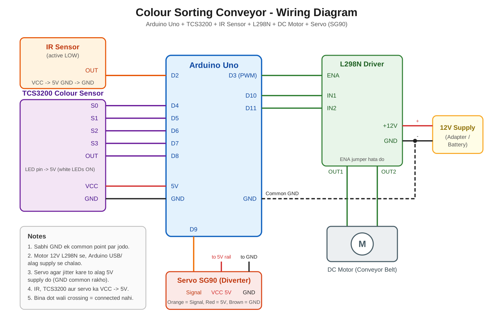
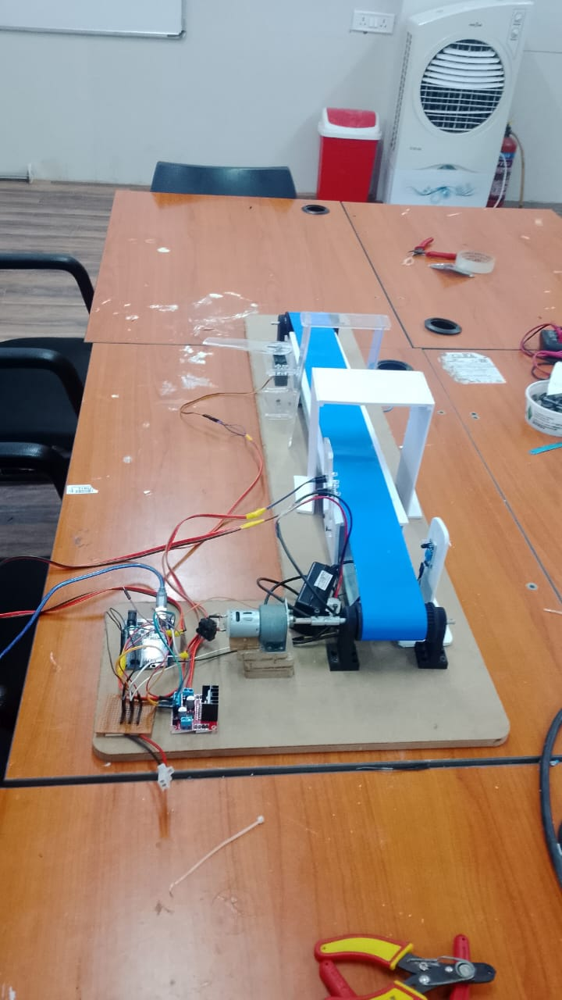
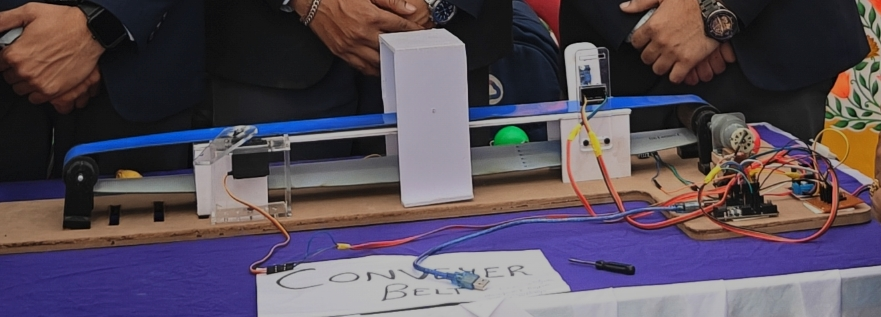
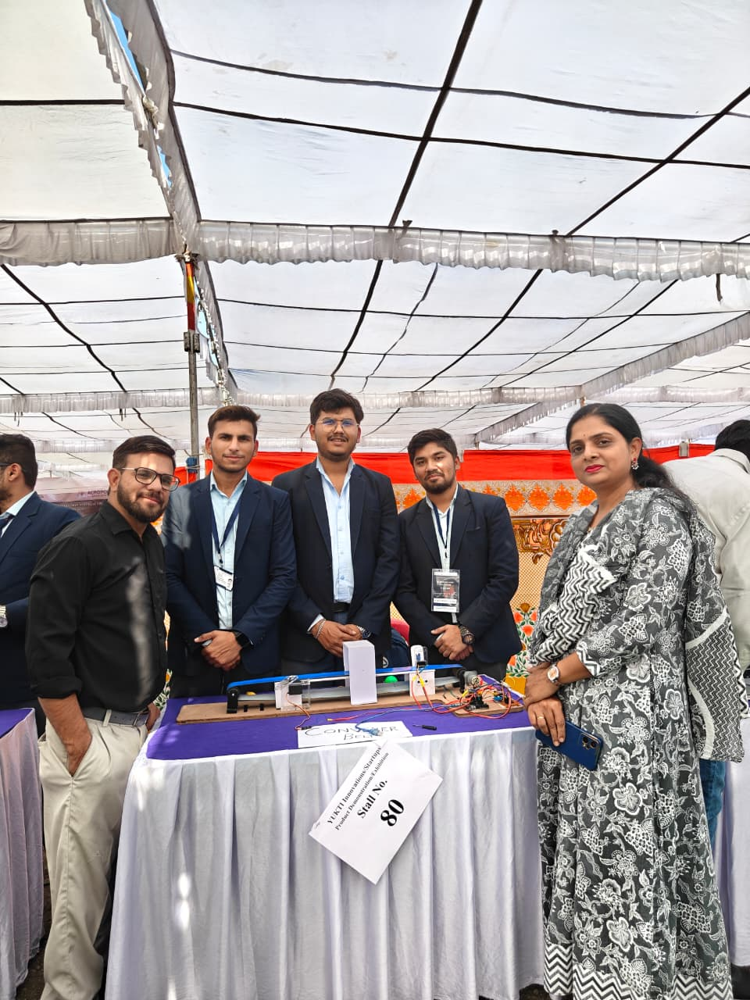

# Colour Sorting Conveyor Belt

An Arduino-based conveyor belt that detects objects with an IR sensor, identifies their colour (**Red / Green / Blue**) with a TCS3200 colour sensor, and sorts them into the correct bin using a servo-driven diverter flap.

Demonstrated at the **YUKTI Innovation / Startups Product Demonstration Exhibition**.



## Features

- Automatic object detection with an active-LOW IR sensor
- RGB colour identification with TCS3200 (5 averaged samples for stable readings)
- 3-way sorting (Red / Green / Blue) with a neutral position for unknown colours
- Belt speed control (PWM) through an L298N motor driver
- Built-in **calibration mode** over Serial Monitor
- All timings, angles and thresholds are configurable at the top of the sketch

## How It Works

1. IR sensor detects an object at the start of the belt and the belt starts moving.
2. When the object reaches the colour sensor the belt stops.
3. TCS3200 reads the red, green and blue channels and the colour is classified.
4. The servo moves the diverter to that colour's angle.
5. The belt runs again so the object falls into the correct bin, then everything resets.

Details and flowchart: [`docs/working_principle.md`](docs/working_principle.md)



## Components Used

| Component | Qty | Purpose |
|---|---|---|
| Arduino Uno R3 | 1 | Main controller |
| TCS3200 colour sensor | 1 | Detect object colour |
| IR obstacle sensor (active LOW) | 1 | Detect object on belt |
| L298N motor driver | 1 | Drive belt motor with PWM speed control |
| 12V DC motor | 1 | Move the conveyor belt |
| SG90 servo motor | 1 | Rotate diverter flap |
| 12V power supply | 1 | Power motor |
| Conveyor belt, rollers, holders, frame, gantry, acrylic servo mount, base board | - | Mechanical structure |

Full list with specifications: [`hardware/components_list.md`](hardware/components_list.md) (spreadsheet: [`components_list.csv`](hardware/components_list.csv))

## Wiring



| Module | Pin | Arduino |
|---|---|---|
| TCS3200 | S0, S1, S2, S3, OUT | D4, D5, D6, D7, D8 |
| IR sensor | OUT | D2 |
| L298N | ENA, IN1, IN2 | D3 (PWM), D10, D11 |
| Servo | Signal | D9 |
| All modules | VCC / GND | 5V / GND (L298N motor supply from 12V, common GND) |

Complete pin table and notes: [`hardware/pin_connections.md`](hardware/pin_connections.md)

## Getting Started

1. Assemble the hardware and wire it as per the diagram.
2. Install the [Arduino IDE](https://www.arduino.cc/en/software).
3. Open `firmware/colour_sorting_conveyor/colour_sorting_conveyor.ino`.
4. Select **Arduino Uno** and the correct port, then upload (the `Servo` library is built in).
5. Calibrate the colour sensor: [`docs/calibration_guide.md`](docs/calibration_guide.md)

## Project Structure

```
colour-sorting-conveyor/
├── docs/
│   ├── working_principle.md
│   ├── calibration_guide.md
│   ├── flowchart.svg
│   └── flowchart.png
├── firmware/
│   └── colour_sorting_conveyor/
│       └── colour_sorting_conveyor.ino
├── hardware/
│   ├── components_list.md
│   ├── components_list.csv
│   ├── pin_connections.md
│   ├── wiring_diagram.svg
│   └── wiring_diagram.png
├── media/
│   ├── README.md
│   ├── workshop_build.png
│   ├── exhibition_side_view.png
│   ├── exhibition_demo.png
│   └── team_at_exhibition.png
├── LICENSE
└── README.md
```

## Gallery

| Build in lab | Working model |
|---|---|
|  |  |

## Team



| Name | Role |
|---|---|
| [Bhanu Pratap Singh Rajpoot](https://github.com/bhanurajpoot04) | Hardware + firmware |
| Teammate 1 | Documentation |
| Teammate 2 | Hardware |

## Known Limitations / Future Work

- Timing-based positioning (no encoder), so belt speed changes affect the stop position.
- Only Red / Green / Blue are recognised; more colours need extra rules.
- Readings depend on lighting; a shaded sensor gantry with LEDs on is recommended.
- Ideas: LCD counter per colour, second IR sensor at the colour sensor position, enclosure, more bins.

## Author

**Bhanu Pratap Singh Rajpoot**
ECE student, Acropolis Institute of Technology & Research, Indore

- GitHub: [bhanurajpoot04](https://github.com/bhanurajpoot04)
- LinkedIn: [bhanu-pratap-singh-rajpoot](https://www.linkedin.com/in/bhanu-pratap-singh-rajpoot)

Other project: [SCARA Robotic Arm with Hand-Gesture Control](https://github.com/bhanurajpoot04/scara-robotic-arm)

If you find this project useful, consider giving the repository a star.

## License

Released under the [MIT License](LICENSE).
